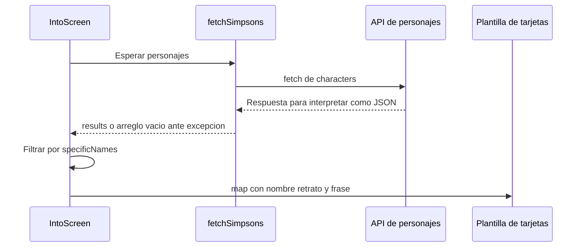
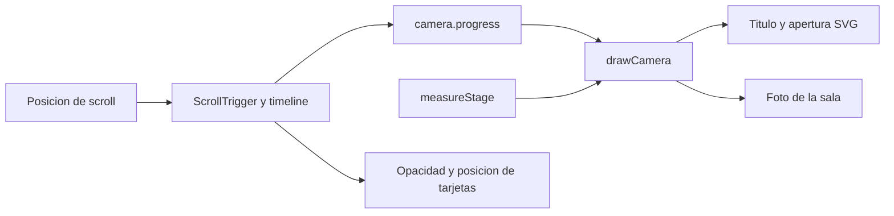
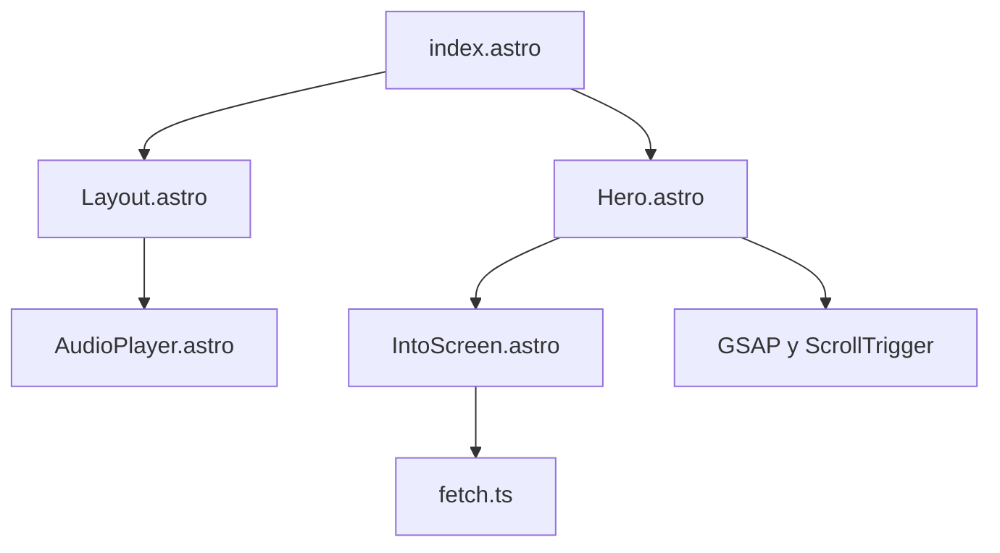

# El libro de ingeniería de The Simpsons

> Comprende la transición por la «P», el recorrido de los datos y las decisiones que hacen posible esta pequeña experiencia web.

**Fecha:** 17 de noviembre de 2026, America/Mexico_City. **Proyecto:** `the-simpsons`, versión declarada `0.0.1`. **Nivel:** principiante, con profundización en geometría y arquitectura. **Tecnologías observadas:** Astro, TypeScript, JavaScript del navegador, GSAP con ScrollTrigger, SVG, CSS y Tailwind mediante Vite. Véanse [package.json:2](package.json#L2), [Hero.astro:129](src/components/Hero.astro#L129) y [astro.config.mjs:3](astro.config.mjs#L3).

**Alcance:** lectura estática de todas las fuentes de aplicación inventariadas, documentación y configuración propias; muestra inicial del lockfile. Se reconstruyen tres flujos: API → tarjetas, scroll → cámara → sala y clic → audio. Los recursos gráficos y sonoros se inventariaron por nombre, sin abrirlos. No se ejecutaron instalaciones, scripts del proyecto, compilaciones, pruebas, servicios, peticiones remotas ni ejercicios. No se verificó la apariencia en un navegador. No hay mediciones de rendimiento ni una certificación de seguridad.

**Cómo estudiar:** lee los capítulos 1–4 para orientarte, recorre el 5 con el editor abierto y dedica otra sesión al 6: ahí está el corazón matemático. Después contrasta tus decisiones con los capítulos 7–14. Usa el glosario, contesta la entrevista sin mirar las respuestas y elige un laboratorio. Los ejercicios son propuestas para realizar posteriormente.

**Cómo interpretar las conclusiones:** **Observación confirmada** significa comprobación en el texto del código; **Inferencia** es una deducción con límites explícitos; **Riesgo potencial** describe un fallo condicionado que requiere pruebas; **Recomendación** propone una evolución. Ninguna de estas etiquetas sustituye una ejecución. Las alternativas de diseño se identifican como **Propuesta no implementada**.

## Índice

1. [Conociendo tu proyecto](#cap-01)
2. [Los fundamentos tecnológicos](#cap-02)
3. [Anatomía y cobertura](#cap-03)
4. [Cómo comienza a funcionar](#cap-04)
5. [Tres recorridos de entrada a salida](#cap-05)
6. [La cámara, los componentes y sus contratos](#cap-06)
7. [La arquitectura observada](#cap-07)
8. [Datos e integraciones](#cap-08)
9. [Seguridad y límites de confianza](#cap-09)
10. [Rendimiento sin métricas inventadas](#cap-10)
11. [Calidad, accesibilidad y pruebas](#cap-11)
12. [Construcción, despliegue y operación](#cap-12)
13. [Evaluación crítica](#cap-13)
14. [Plan de evolución](#cap-14)
15. [Glosario técnico](#cap-15)
16. [Defiende tu proyecto](#cap-16)
17. [Laboratorio de aprendizaje](#cap-17)

<a id="cap-01"></a>
## Capítulo 1 — Conociendo tu proyecto

El problema que resuelve este repositorio es visual: producir la sensación de atravesar el título de Los Simpson y entrar en su sala usando el desplazamiento de una página. La intención documentada procede de una transición de Fortnite; el README especifica que la entrada definitiva pasa por la «P». Esto describe la intención del autor, no una evaluación de fidelidad frente al videojuego. [README.md:7](README.md#L7), [README.md:14](README.md#L14).

**Observación confirmada.** La página compone una escena con una fotografía de sala, un cielo vectorial con nubes, un título SVG y tarjetas de personajes. Un control de audio vive fuera de esa escena, dentro del layout. Las tarjetas seleccionan cinco nombres de la familia a partir de datos externos y muestran un retrato, un nombre y una frase. [Hero.astro:50](src/components/Hero.astro#L50), [Hero.astro:114](src/components/Hero.astro#L114), [IntoScreen.astro:13](src/components/IntoScreen.astro#L13), [Layout.astro:16](src/layouts/Layout.astro#L16).

La experiencia tiene dos clases de trabajo. Primero se prepara el documento: se consultan datos y se produce HTML, el lenguaje que estructura una página. Después, en el navegador, el scroll mueve la cámara y los clics intentan reproducir audio. Confundir esos momentos lleva a un error de mantenimiento importante: cambiar la API no implica que una página ya publicada vuelva a consultar personajes en cada visita. El capítulo 4 explica el supuesto de salida estática que sostiene esta distinción.

No se observan navegación entre pantallas, edición de personajes, almacenamiento de preferencias ni cuentas de usuario en las fuentes inspeccionadas. Las tarjetas tampoco implementan un detalle al hacer clic: hay clases de cursor y hover, pero no un manejador de apertura. El producto comprobable es una experiencia de transición con contenido, no un catálogo interactivo completo. [index.astro:6](src/pages/index.astro#L6), [IntoScreen.astro:33](src/components/IntoScreen.astro#L33).

El valor educativo está en coordinar sistemas distintos: coordenadas SVG, tamaños en píxeles CSS, una línea temporal de animación y datos que pueden fallar. Una buena defensa del proyecto explica cómo se mantienen sincronizados y qué pasa cuando alguno falta. Pregunta inicial: **si la API no responde, debería seguir funcionando la transición?** El código intenta que sí, devolviendo una lista vacía, aunque esa protección no cubre todos los formatos inválidos.

<a id="cap-02"></a>
## Capítulo 2 — Los fundamentos tecnológicos

Un navegador representa el HTML mediante el **DOM**, un árbol de elementos que JavaScript puede consultar y modificar. CSS define presentación y distribución. Una biblioteca de animación modifica propiedades del [DOM](#g-dom) a lo largo de una progresión; no sustituye la estructura del documento. Aquí Astro prepara componentes y los scripts del navegador manipulan los elementos ya presentes.

### Astro y la separación de momentos

Un archivo `.astro` combina un bloque inicial entre `---`, una plantilla y, cuando hace falta, scripts y estilos. En este proyecto el bloque inicial de `IntoScreen` espera datos; su plantilla los transforma en tarjetas. El `<script>` de `Hero` consulta el DOM y registra ScrollTrigger. Son responsabilidades con tiempos de ejecución distintos. [IntoScreen.astro:1](src/components/IntoScreen.astro#L1), [Hero.astro:128](src/components/Hero.astro#L128).

Astro permite componer el documento sin introducir un sistema de componentes cliente como React. Eso es una ventaja plausible para una escena pequeña: el código de interacción puede limitarse a lo que necesita el navegador. El costo es que el estado y la sincronización del DOM quedan a cargo de los scripts. No se observa hidratación de componentes de otro framework. Para mantenerlo necesitas entender el bloque inicial, las rutas de `src/pages`, los slots y el alcance de estilos. Una alternativa sería HTML con un empaquetador; simplificaría una dependencia, pero exigiría resolver por otra vía la composición y preparación de datos. **Propuesta no implementada**, sin necesidad demostrada de migrar.

### TypeScript: describir no equivale a comprobar

TypeScript añade descripciones de tipos a JavaScript para detectar incompatibilidades durante el desarrollo. `Promise<Characters[]>` expresa lo que promete una función asíncrona: un resultado futuro que debería ser un arreglo. No valida por sí mismo el JSON recibido por red. Un [contrato de datos](#g-contract) exige comprobar también los valores en ejecución. [fetch.ts:4](src/services/fetch.ts#L4), [fetch.ts:11](src/services/fetch.ts#L11).

La configuración extiende el modo estricto de Astro. Sin embargo, `any` en el consumidor permite tratar cada personaje sin verificación estática útil y la interfaz local `Character` no se usa en esos callbacks. Esta diferencia entre intención y uso es más importante que tener una extensión `.ts`. [tsconfig.json:2](tsconfig.json#L2), [IntoScreen.astro:6](src/components/IntoScreen.astro#L6), [IntoScreen.astro:21](src/components/IntoScreen.astro#L21). Mantener este sistema requiere distinguir `string` de `String`, tipos de valores reales y errores de compilación de errores de red.

### GSAP, ScrollTrigger y CSS

GSAP es el motor que interpola valores mediante [tweens](#g-timeline): calcula estados intermedios entre un comienzo y un destino. ScrollTrigger conecta la progresión de una línea temporal con la posición de scroll. El proyecto importa ambos, registra el plugin y crea una `timeline` cuyo disparador es el propio hero. CSS mantiene la escena en pantalla con `position: sticky`; no se configura `pin` en ScrollTrigger. [Hero.astro:129](src/components/Hero.astro#L129), [Hero.astro:273](src/components/Hero.astro#L273), [Hero.astro:323](src/components/Hero.astro#L323).

Su ventaja aquí es coordinar nubes, un objeto de cámara y tarjetas dentro de una secuencia reversible. El costo es aprender posiciones de timeline, limpieza y refresco de medidas, además de cargar el motor. Una alternativa con APIs de animación nativas requeriría reconstruir esa coordinación y comprobar compatibilidad. **Propuesta no implementada.** Antes de cambiar de herramienta conviene demostrar un problema de tamaño, rendimiento o mantenimiento.

### SVG y la máscara

SVG describe gráficos con formas y coordenadas en lugar de una cuadrícula fija de píxeles. Un `viewBox` define el rectángulo de coordenadas que se proyecta sobre la pantalla. Una máscara controla cuánto de una capa se ve. Aquí un rectángulo blanco conserva el cielo y un trazado negro abre la «P», dejando visible la foto colocada detrás. El título se dibuja en un grupo aparte. [Hero.astro:62](src/components/Hero.astro#L62), [Hero.astro:73](src/components/Hero.astro#L73), [Hero.astro:109](src/components/Hero.astro#L109).

Esto permite una abertura irregular alineada con una letra. El costo es mantener de acuerdo el arte, el pivote y las medidas de la abertura. Una transición basada solo en opacidad sería más sencilla, pero cambiaría el efecto central. **Propuesta no implementada.** Aprender transformaciones y proyección aporta más valor que memorizar las constantes.

### Tailwind, Vite y pnpm

Tailwind ofrece utilidades CSS que se combinan en atributos `class`: por ejemplo, la grilla usa dos columnas y cambia a cinco con `md:grid-cols-5`. Vite participa en la construcción y recibe el plugin de Tailwind. El CSS global importa `tailwindcss`. Las reglas geométricas particulares permanecen como CSS en `Hero`, lo cual evita expresar toda la escena mediante utilidades. [IntoScreen.astro:31](src/components/IntoScreen.astro#L31), [astro.config.mjs:8](astro.config.mjs#L8), [global.css:1](src/styles/global.css#L1).

pnpm es el gestor de paquetes evidenciado por su lockfile y sus reglas de construcción autorizada para `esbuild` y `sharp`. Estas reglas pertenecen a la instalación, no a la interacción del usuario. [package.json:11](package.json#L11), [pnpm-workspace.yaml:1](pnpm-workspace.yaml#L1). CSS escrito a mano es una alternativa a Tailwind; cambia consistencia y forma de mantenimiento, no la lógica de cámara.

### Versiones: tres preguntas diferentes

| Tecnología | Rango declarado | Versión resuelta en el importador del lockfile | Uso comprobado |
| --- | --- | --- | --- |
| Astro | `^5.15.5` | `5.18.1` | Componentes y configuración |
| GSAP | `^3.13.0` | `3.15.0` | Cámara, timeline y ScrollTrigger |
| Tailwind CSS | `^4.1.17` | `4.3.0` | Utilidades e importación CSS |
| Plugin Tailwind para Vite | `^4.1.17` | `4.3.0` | `tailwindcss()` en configuración |

Fuentes: [package.json:14](package.json#L14) y [pnpm-lock.yaml:11](pnpm-lock.yaml#L11). El rango admite actualizaciones compatibles; el lockfile registra una resolución concreta. **No se inspeccionó la instalación:** no afirmamos que esas versiones estén efectivamente cargadas en una máquina o despliegue. Tampoco se consultaron avisos de vulnerabilidad ni se declara vulnerable una dependencia por su número de versión.

<a id="cap-03"></a>
## Capítulo 3 — Anatomía y cobertura

Una responsabilidad es un motivo coherente para cambiar una pieza. Si cambia el encuadre de la cámara, debería ser fácil localizar su código; si cambia el proveedor de personajes, debería poder encontrarse la integración sin recorrer todo el sitio. Este mapa sirve para orientarse:

```text
src/
  pages/index.astro            composición de la ruta principal
  layouts/Layout.astro        documento, estilo global y audio
  components/Hero.astro       escena, geometría y animación
  components/IntoScreen.astro obtención y presentación de tarjetas
  components/AudioPlayer.astro reproducción y botón
  services/fetch.ts           petición de personajes
  styles/global.css          entrada de Tailwind
  assets/simpsons-title.svg   título importado por Hero
public/                       nubes, título, foto y audio
astro.config.mjs              integración de construcción
package.json                 dependencias y comandos
pnpm-lock.yaml               resolución de dependencias
pnpm-workspace.yaml          permisos de construcción de paquetes
```

El árbol resume nombres revisados; no reproduce instalaciones ni datos privados. Hay un título en `src/assets` y otro en `public`: el import comprobado del hero apunta al primero. No se compararon los SVG ni se infiere que sean idénticos. [Hero.astro:2](src/components/Hero.astro#L2).

### Cobertura efectiva de lectura

| Grupo | Archivos y rangos comprendidos | Qué permite afirmar |
| --- | --- | --- |
| Composición | `src/pages/index.astro` 1–10; `src/layouts/Layout.astro` 1–28 | Ruta, layout, slot y audio |
| Escena | `src/components/Hero.astro` 1–384 | Marcado, cámara, medición, timeline, CSS y alternativas de movimiento |
| Contenido | `src/components/IntoScreen.astro` 1–68; `src/services/fetch.ts` 1–22 | Petición, filtrado, consumo y errores |
| Audio | `src/components/AudioPlayer.astro` 1–66 | Estado, reproducción y listeners |
| Estilos | `src/styles/global.css` 1 | Entrada de Tailwind |
| Configuración | `package.json` 1–20; `astro.config.mjs` 1–11; `tsconfig.json` 1–5; `pnpm-workspace.yaml` 1–3 | Dependencias, scripts y configuración propia |
| Contexto | `README.md` 1–46; `.gitignore` 1–24 | Intención documentada y exclusiones declaradas |
| Resolución | `pnpm-lock.yaml` 1–85 de 3805 líneas | Se interpretó especialmente el importador raíz 1–22; no toda la red transitiva |

El inventario filtrado final contiene 14 archivos de texto. Además se identificaron por nombre diez recursos SVG, JPG y M4A fuera de los formatos de lectura del auxiliar. **Inventariar no equivale a leer; leer no equivale a ejecutar.** No se examinaron contenido de imágenes, audio, trazados SVG originales, paquetes instalados, salida compilada, historial Git ni configuración del proveedor de alojamiento.

El auxiliar no interpreta `.gitignore`. La primera exploración devolvió extractos automáticos de `.astro`; se excluyeron expresamente del segundo inventario y de las conclusiones, junto con `skills-lock.json`, metadatos de herramientas ajenos al producto. También se omiten `.git`, instalaciones de agentes, dependencias, cachés, binarios y cualquier archivo sensible filtrado, incluidos `.env*`, credenciales y registros. No se eludió el filtro para leerlos. No hubo errores de lectura en las fuentes autorizadas.

### Evidencia esencial

| ID | Tipo y afirmación | Referencia |
| --- | --- | --- |
| E1 | Observación confirmada: la intención es atravesar la «P» | [README.md:7](README.md#L7) |
| E2 | Observación confirmada: la ruta compone layout y hero | [index.astro:6](src/pages/index.astro#L6) |
| E3 | Observación confirmada: el servicio devuelve `results` o `[]` | [fetch.ts:11](src/services/fetch.ts#L11) |
| E4 | Observación confirmada: el consumidor filtra por cinco nombres | [IntoScreen.astro:13](src/components/IntoScreen.astro#L13) |
| E5 | Observación confirmada: título y apertura reciben la misma matriz expresada como transformaciones | [Hero.astro:186](src/components/Hero.astro#L186) |
| E6 | Observación confirmada: medición y dibujo se separan | [Hero.astro:219](src/components/Hero.astro#L219) |
| E7 | Riesgo potencial: fallo de inicialización deja capas ocultas con movimiento normal | [Hero.astro:365](src/components/Hero.astro#L365) |
| E8 | Observación confirmada: audio tiene un listener local y otro global de primer clic | [AudioPlayer.astro:44](src/components/AudioPlayer.astro#L44) |

Las referencias del libro amplían este registro con cada conclusión. No se observaron archivos de pruebas, CI, contenedores ni adaptadores de servidor en el inventario propio inspeccionado. Esta conclusión se limita a ese inventario y no describe infraestructura externa ni archivos excluidos.

<a id="cap-04"></a>
## Capítulo 4 — Cómo comienza a funcionar

Un **proceso** es un programa en ejecución. En desarrollo suele existir un proceso que prepara y sirve la página; en producción estática se entregan archivos previamente construidos. El navegador constituye otro entorno: recibe HTML, CSS y JavaScript y luego ejecuta las interacciones.

Los comandos siguientes están definidos como texto en el manifiesto. Se explican para el lector; **no se ejecutaron durante el análisis**. [package.json:5](package.json#L5).

| Invocación mediante pnpm | Script declarado | Propósito |
| --- | --- | --- |
| `pnpm dev` | `astro dev` | Desarrollo local con Astro |
| `pnpm build` | `astro build` | Preparación de la salida publicable |
| `pnpm preview` | `astro preview` | Vista previa local de una construcción |
| `pnpm astro` | `astro` | Acceso al CLI de Astro |

La configuración registra Tailwind como plugin de Vite. No declara `output: 'server'` ni un adaptador. **Inferencia:** la aplicación está planteada para la salida estática predeterminada de Astro; el bloque inicial de `IntoScreen` prepara entonces los personajes durante la construcción, mientras que el servidor de desarrollo puede volver a preparar la página al solicitarla. No hay evidencia de una compilación ejecutada que permita asegurar el artefacto final. [astro.config.mjs:6](astro.config.mjs#L6), [IntoScreen.astro:4](src/components/IntoScreen.astro#L4).

La ruta `src/pages/index.astro` importa `Hero` y `Layout`. El layout crea el documento completo, añade `AudioPlayer` y coloca el contenido de la ruta mediante `<slot />`. El hero incluye `IntoScreen`; esa inclusión hace relevante la llamada a `fetchSimpsons`. El módulo se importa como `fetch.js` aunque el archivo fuente es `fetch.ts`: se debe comprobar con las herramientas del proyecto antes de etiquetarlo como error; esta lectura no encontró un fallo de resolución ejecutado. [index.astro:2](src/pages/index.astro#L2), [Layout.astro:15](src/layouts/Layout.astro#L15), [Hero.astro:115](src/components/Hero.astro#L115), [IntoScreen.astro:2](src/components/IntoScreen.astro#L2).

En el navegador, `Hero` busca los elementos necesarios y solo entra en la configuración si existen hero, escenario, foto, SVG y apertura. La rama animada se activa para `prefers-reduced-motion: no-preference`. Se marca `data-portal-motion`, se mide el escenario, se dibuja el primer estado y se crea la timeline. La presencia de un atributo del DOM sirve aquí como señal entre JavaScript y CSS: CSS añade recorrido vertical solo cuando la animación se ha activado. [Hero.astro:134](src/components/Hero.astro#L134), [Hero.astro:269](src/components/Hero.astro#L269), [Hero.astro:318](src/components/Hero.astro#L318).

La protección contra elementos ausentes evita algunas excepciones, pero no muestra un mensaje si falla la inicialización. El [fallback](#g-fallback) `noscript` solo aplica cuando JavaScript está deshabilitado; un script que falla con JavaScript habilitado requiere otra estrategia. La comprobación propuesta consiste en bloquear el módulo cliente y observar si queda contenido legible, sin confundir ese ensayo con algo ya verificado.

Pregunta de reflexión: **qué parte seguiría existiendo si borrases el script de cámara del HTML generado?** Las tarjetas estarían en el documento si se prepararon bien, pero sus estilos iniciales y los de la sala pueden impedir verlas. Existencia de HTML y disponibilidad visual son contratos diferentes.

<a id="cap-05"></a>
## Capítulo 5 — Tres recorridos de entrada a salida

### Recorrido A: de la petición a las tarjetas

Una **petición** solicita un recurso a otro sistema. Una **respuesta** incluye un estado y un cuerpo; JSON es una representación textual de valores. El servicio necesita convertir ese cuerpo en objetos antes de que la plantilla pueda iterarlos.

Fragmento real de `fetchSimpsons`, [fetch.ts:11](src/services/fetch.ts#L11):

```ts
export async function fetchSimpsons(): Promise<Characters[]> {
    try {
        const response = await fetch(url);
        const data = await response.json();
        console.log(data)
        return data.results || [];
    } catch(error) {
        console.error("Error:", error);
        return [] as Characters[];
    }
}
```

`IntoScreen` llama a la función y espera el resultado. Después filtra por pertenencia a `specificNames`; finalmente `map` produce cada tarjeta. El nombre funciona como criterio de selección, el `id` como parte del identificador DOM y `portrait_path` como sufijo de una URL de CDN. Se muestra `phrases?.[2]`, la tercera frase cuando existe. [IntoScreen.astro:4](src/components/IntoScreen.astro#L4), [IntoScreen.astro:21](src/components/IntoScreen.astro#L21), [IntoScreen.astro:33](src/components/IntoScreen.astro#L33).

**Diagrama: preparación de personajes.** Cada relación corresponde a las llamadas anteriores y al retorno observado. La plantilla se prepara en Astro; no se dibuja una petición cliente de personajes que no existe en el script del navegador.



El flujo de error tiene matices:

- Si `fetch` o la lectura de JSON arroja una excepción, se registra el error y se devuelve `[]`. La plantilla genera cero tarjetas, sin aviso visible específico.
- Si el servidor responde con error HTTP y un JSON interpretable, el código no consulta `response.ok`; no distingue ese estado de una respuesta correcta.
- Si `results` falta o es falsy, retorna `[]`. Si es truthy pero no es un arreglo, sale del servicio y puede fallar `allCharacters.filter`. Ese fallo ocurre fuera del `try` del servicio.
- Incluso con un arreglo válido, cada miembro puede carecer de `name`, `portrait_path` o `phrases` del tipo esperado. `any` no protege esa frontera.

Todo ello es **observación confirmada del control de flujo**; la disponibilidad, el contenido actual y la paginación efectiva del proveedor no se consultaron. No se envían credenciales ni se implementa un control de permisos de aplicación en esta función. No deben añadirse explicaciones de login a un flujo que no lo tiene.

La decisión actual favorece continuidad ante errores capturados: sala y animación pueden prepararse sin personajes. El costo es ocultar la diferencia entre «no hay resultados» y «no pudimos cargarlos». **Recomendación:** devolver un resultado distinguible de éxito o fallo y validar datos antes de devolverlos. La comprobación debería usar respuestas controladas, no depender de que la API externa falle por casualidad.

### Recorrido B: del scroll a la cámara y las tarjetas

El scroll aporta una posición; ScrollTrigger la relaciona con el tramo entre `top top` y `bottom bottom` del hero. GSAP avanza una timeline: abre las cortinas de nubes, modifica `camera.progress`, llama a `drawCamera`, oculta la intro y muestra las tarjetas si hay alguna. [Hero.astro:273](src/components/Hero.astro#L273), [Hero.astro:286](src/components/Hero.astro#L286).

`drawCamera` no incrementa una escala acumulada a cada evento. La vuelve a calcular a partir del progreso y las medidas vigentes. Por eso el diseño permite recorrer los mismos estados al bajar y al subir. Es una propiedad del cálculo, no una garantía visual probada en todos los dispositivos. [Hero.astro:186](src/components/Hero.astro#L186).

**Diagrama: dependencias del dibujo.** Las flechas indican actualización o cálculo observado; `measureStage` alimenta medidas y `drawCamera` escribe transformaciones.



El enlace `measureStage → drawCamera` expresa que el segundo usa variables escritas por el primero, no una llamada directa dentro de `measureStage`. Ambos se llaman inicialmente y se conectan al refresco de ScrollTrigger por callbacks separados. [Hero.astro:219](src/components/Hero.astro#L219), [Hero.astro:269](src/components/Hero.astro#L269), [Hero.astro:281](src/components/Hero.astro#L281).

Si faltan elementos esenciales, no se configura la escena. Si no hay tarjetas, la cámara sigue teniendo su recorrido y simplemente no se añade el tween de tarjetas. Si hay preferencia de movimiento reducido, no se ejecuta la rama animada y CSS oculta la intro y hace opacas las tarjetas. [Hero.astro:140](src/components/Hero.astro#L140), [Hero.astro:295](src/components/Hero.astro#L295), [Hero.astro:375](src/components/Hero.astro#L375).

### Recorrido C: del clic a la reproducción

El **estado** es la información que cambia y determina el comportamiento. `AudioPlayer` guarda `isPlaying`, inicialmente falso. `playAudio` espera `audio.play()`: si se resuelve, marca reproducción y cambia iconos; si rechaza, deja el booleano falso. Al pulsar el botón, si el estado era verdadero llama a `pause`; en caso contrario vuelve a intentar reproducir. [AudioPlayer.astro:29](src/components/AudioPlayer.astro#L29), [AudioPlayer.astro:32](src/components/AudioPlayer.astro#L32), [AudioPlayer.astro:44](src/components/AudioPlayer.astro#L44).

El elemento `<audio>` tiene `loop` y una fuente local, sin atributo `autoplay`. El intento automático procede de un listener de `DOMContentLoaded`. Hay además un listener global de primer clic que intenta reproducir si `isPlaying` es falso. Es un intento de recuperarse de una denegación de reproducción; no garantiza el permiso del navegador ni informa de un archivo ilegible. [AudioPlayer.astro:19](src/components/AudioPlayer.astro#L19), [AudioPlayer.astro:55](src/components/AudioPlayer.astro#L55).

**Riesgo potencial.** Si la reproducción inicial tuvo éxito y el primer clic de la página pulsa el botón para pausar, el manejador del botón cambia `isPlaying` a falso; después ese clic puede propagarse al documento y el listener global volver a reproducir. La condición específica importa: no significa que todos los clics de pausa fallen. Hace falta una prueba de navegador con reproducción inicial permitida. La solución propuesta es unificar el inicio y la intención explícita de pausa, además de sincronizar estado e iconos con eventos del elemento de audio.

Este caso enseña una idea reutilizable: dos manejadores correctos por separado pueden producir una interacción incorrecta cuando responden al mismo evento. Una pregunta útil es **quién es la autoridad sobre el estado: el booleano, el medio o el último clic?**

<a id="cap-06"></a>
## Capítulo 6 — La cámara, los componentes y sus contratos

### Un objetivo visual convertido en invariantes

Una **invariante** es una condición que debe conservarse mientras el sistema cambia. Aquí hay tres especialmente útiles: título y abertura deben permanecer alineados; el hueco visible debe tener fotografía detrás; la foto debe conservar su proporción. El código intenta sostenerlas mediante una transformación común, un cálculo de cobertura y una escala uniforme. [Hero.astro:186](src/components/Hero.astro#L186), [Hero.astro:205](src/components/Hero.astro#L205), [Hero.astro:341](src/components/Hero.astro#L341).

Piensa en dos sistemas de coordenadas. El SVG trabaja en sus unidades internas; el escenario tiene ancho y alto en píxeles CSS. `viewBoxFit` relaciona el [viewBox](#g-viewbox) con el escenario y calcula el factor que permite encajar el rectángulo del título en el escenario. `projection = scale * viewBoxFit` combina el zoom de cámara con esa conversión. Sin esa separación sería fácil comparar un borde SVG con un ancho de foto medido en otra unidad.

### El pivote común

El bloque inicial fija el [pivote](#g-pivot) en `(544, 248)` y define un `viewBox` de 1074 por 580 centrado en él. Por sustitución, `viewX` vale 7 y `viewY` vale −42. El script vuelve a obtener ese centro leyendo el `viewBox` real. La derivación es aritmética del código, no una medición de la imagen. [Hero.astro:7](src/components/Hero.astro#L7), [Hero.astro:158](src/components/Hero.astro#L158).

Fragmento real de `drawCamera`, [Hero.astro:186](src/components/Hero.astro#L186):

```js
function drawCamera() {
  const scale = startScale * (endScale / startScale) ** camera.progress;
  const transform = `translate(${centerX} ${centerY}) scale(${scale}) translate(${-centerX} ${-centerY})`;

  cameraLayers.forEach((layer) => layer.setAttribute("transform", transform));
```

El fragmento termina antes del resto de la función. `cameraLayers` selecciona los dos elementos marcados `data-portal-camera`: el trazado de la máscara y el grupo del título. La composición de transformaciones equivale a trasladar un punto para medirlo respecto del centro, escalar esa distancia y devolverlo al centro. Así el punto pivote permanece fijo. El orden de operaciones importa: escalar alrededor del origen sin compensar trasladaría la abertura. [Hero.astro:75](src/components/Hero.astro#L75), [Hero.astro:109](src/components/Hero.astro#L109), [Hero.astro:142](src/components/Hero.astro#L142).

La escala es **geométrica**. Si el progreso vale cero, queda `startScale`; si vale uno, queda `endScale`; a mitad de progreso, la escala es la media geométrica de ambas. Incrementos iguales del progreso multiplican la escala por un mismo factor. Esto es distinto de sumar cantidades iguales. Además, la timeline aplica [easing](#g-easing) al avance de `camera.progress`: igual distancia de scroll no implica necesariamente igual incremento de ese objeto. Mantener separadas ambas transformaciones conceptuales evita explicar el zoom como una simple recta. [Hero.astro:172](src/components/Hero.astro#L172), [Hero.astro:274](src/components/Hero.astro#L274), [Hero.astro:291](src/components/Hero.astro#L291).

**Compromiso:** el pivote y el contorno están acoplados al arte actual. Si se sustituye el título por otro con dimensiones diferentes, no basta con cambiar la importación. Habrá que revisar `aperturePath`, `pivot`, tamaños, radios internos y encuadre. La comprobación adecuada compara apertura y título al principio, durante el zoom y al final, en varios formatos de pantalla.

### Medir antes de dibujar

`measureStage` toma dimensiones del escenario y de la foto. No se invoca para cada actualización de la cámara: se usa al inicializar y en `onRefreshInit`. `drawCamera` usa esos valores y escribe transformaciones. Separar lecturas de layout de escrituras frecuentes es una decisión de mantenimiento y una oportunidad de rendimiento; no demuestra por sí sola una tasa de cuadros concreta. [Hero.astro:219](src/components/Hero.astro#L219), [Hero.astro:281](src/components/Hero.astro#L281).

Fragmento real del cálculo de escala final, [Hero.astro:233](src/components/Hero.astro#L233):

```js
// Fit all four viewport corners inside the opening before removing the sky.
endScale = 1.04 * Math.hypot(
  visibleWidth / (2 * opening.radiusX),
  visibleHeight / (2 * opening.radiusY),
);
```

Una elipse centrada con radios `rx` y `ry` contiene un punto cuando la suma de sus coordenadas normalizadas al cuadrado no supera uno. Para una esquina del viewport, las distancias al centro son la mitad del ancho y del alto visibles. Al ampliar ambos radios por la misma escala, despejar esa condición produce la raíz de la suma de cuadrados, calculada por `Math.hypot`. El factor `1.04` añade margen al resultado. Los radios `11.5` y `20` son constantes del código; el comentario afirma que la elipse cabe dentro de la «P», pero no se verificó esa inclusión contra el arte original. Por eso la garantía geométrica es condicional a esa premisa. [Hero.astro:161](src/components/Hero.astro#L161).

El método ofrece una explicación concreta de cuándo ocultar el cielo: después de que la abertura ampliada pueda contener toda la pantalla. Evita elegir una escala final sin relación con la proporción del dispositivo. Su costo es mantener válida la elipse si cambia el contorno.

### La fotografía cubre el hueco sin estirarse

CSS calcula el ancho base de la foto como el máximo entre el ancho del escenario y el ancho necesario para cubrir su altura con relación 16:9. El alto queda automático. El marcado declara dimensiones 1280×720; no se abrió el JPG para comprobar las dimensiones reales, de modo que mantener el recurso coherente con esas suposiciones forma parte del contrato. [Hero.astro:55](src/components/Hero.astro#L55), [Hero.astro:346](src/components/Hero.astro#L346).

`aperture.getBBox()` aporta los límites del trazado; se amplían ligeramente y se expresan respecto del centro. `apertureCover` calcula una escala base de foto suficiente para cubrir la anchura y altura de esa abertura, con factor `1.12`. Durante el dibujo, `apertureScale` proyecta esa relación al zoom actual. `coverScale`, `settle`, `push` y `reframe` suavizan el paso desde el recorte pequeño hasta el encuadre completo. [Hero.astro:163](src/components/Hero.astro#L163), [Hero.astro:231](src/components/Hero.astro#L231), [Hero.astro:192](src/components/Hero.astro#L192).

[`clamp`](#g-clamp) limita un valor a un intervalo. Aquí restringe `roomX` y `roomY` para que al desplazar la foto no queden bordes de la abertura sin cubrir. La posición horizontal final favorece el foco `roomFocusX = 0.39`, coordinado con `left: 39%` y `translate: -39% -50%` del CSS. El `transform` escrito por JavaScript compensa la colocación base y aplica una escala uniforme. Ese reparto entre CSS y JavaScript es preciso, pero exige que los valores de foco sigan concordando si se modifica el encuadre. [Hero.astro:174](src/components/Hero.astro#L174), [Hero.astro:202](src/components/Hero.astro#L202), [Hero.astro:215](src/components/Hero.astro#L215), [Hero.astro:345](src/components/Hero.astro#L345).

### Nubes, tiempo y reversibilidad

Los datos de `cloudCurtains` describen posiciones relativas y escalas. Durante la preparación del HTML se convierten en atributos `data-*`; el script los lee y calcula posiciones según columnas del escenario y `viewBoxFit`. Esto es un pequeño contrato entre el bloque inicial de Astro y JavaScript cliente: `data-width`, `data-height`, `data-top` y `data-scale` deben seguir siendo números válidos. [Hero.astro:23](src/components/Hero.astro#L23), [Hero.astro:90](src/components/Hero.astro#L90), [Hero.astro:146](src/components/Hero.astro#L146), [Hero.astro:252](src/components/Hero.astro#L252).

La timeline abre nubes desde la etiqueta `clouds` en 0; empieza el avance de cámara en `push` a 0.2; sitúa `room` al final del tween previo; oculta la intro y añade las tarjetas con un desfase posterior. Con `scrub`, las duraciones distribuyen proporciones del recorrido de scroll; no deben describirse como segundos de reproducción autónoma en esta experiencia. El valor `scrub: 0.35` suaviza el seguimiento. [Hero.astro:279](src/components/Hero.astro#L279), [Hero.astro:286](src/components/Hero.astro#L286).

La reversibilidad se apoya en recalcular desde un estado conocido y recorrer una timeline común. No se observa un segundo algoritmo para subir. La devolución de limpieza retira `data-portal-motion` y el `transform` manual de la foto; no hay una destrucción de página completa documentada aquí, por lo que una futura navegación cliente exigiría revisar montaje y desmontaje. [Hero.astro:303](src/components/Hero.astro#L303).

### Contratos entre componentes

| Productor | Contrato observado | Consumidor y efecto de romperlo |
| --- | --- | --- |
| `fetchSimpsons` | Resultado que el consumidor espera como arreglo | `IntoScreen.filter`: puede lanzar si recibe otro tipo |
| `IntoScreen` | `#content-characters` e identificadores `card-*` | `Hero` selecciona tarjetas para animarlas |
| Marcado de `Hero` | Elementos `data-portal-*` | El script configura o salta la escena |
| CSS de sala | Aspecto supuesto y foco horizontal | Cálculos de cobertura y desplazamiento |
| Elemento de audio | Promesa de `play`, estado del medio | `isPlaying` e iconos deben reflejarlo |

Fuentes: [IntoScreen.astro:27](src/components/IntoScreen.astro#L27), [Hero.astro:134](src/components/Hero.astro#L134), [Hero.astro:156](src/components/Hero.astro#L156), [AudioPlayer.astro:32](src/components/AudioPlayer.astro#L32). Un cambio de selector puede romper un contrato tan real como cambiar la firma de una función. Pregunta de reflexión: **qué prueba detectaría renombrar `card-*` sin actualizar el hero?**

<a id="cap-07"></a>
## Capítulo 7 — La arquitectura observada

La **arquitectura** explica responsabilidades y dirección de dependencias. La **cohesión** mide cuánto comparten un propósito las partes de un módulo; el **acoplamiento** expresa cuánto debe conocer una pieza sobre otra para funcionar.

**Arquitectura declarada.** El README describe una implementación en Astro, GSAP, ScrollTrigger y Tailwind, centrada en una transformación compartida de título y recorte. No declara Clean Architecture, MVC ni una separación formal por capas. [README.md:7](README.md#L7), [README.md:12](README.md#L12).

**Arquitectura observada.** Hay una ruta, un layout, componentes Astro y un módulo de acceso remoto. `Hero` reúne marcado, configuración de arte, geometría, animación y CSS; `IntoScreen` reúne consulta, selección de personajes y presentación; `AudioPlayer` encapsula su marcado y comportamiento. El servicio separa la petición, pero el consumidor sigue conociendo nombres exactos y la URL del CDN. [index.astro:1](src/pages/index.astro#L1), [Hero.astro:1](src/components/Hero.astro#L1), [IntoScreen.astro:1](src/components/IntoScreen.astro#L1), [fetch.ts:1](src/services/fetch.ts#L1).

**Diagrama: composición observada.** Una flecha representa uso o inclusión, no llamada de red ni dependencia de despliegue.



**Patrones parciales.** Se observa composición de vistas y una función de servicio, así como separación interna entre medir y dibujar. Eso no demuestra inversión de dependencias ni un dominio independiente de la interfaz. La configuración de cámara está cerrada sobre variables locales y elementos DOM; no es un motor reutilizable sin adaptaciones.

Esta sencillez es adecuada para una experiencia de una sola página. **Observación confirmada:** el código está cerca del efecto que produce; se puede seguir de principio a fin sin rastrear un almacén global de estado. **Inferencia:** esa cercanía puede abaratar cambios visuales pequeños. El [acoplamiento](#g-coupling) aparece cuando se cambia algo transversal: un nuevo título toca geometría y arte; un nuevo proveedor toca servicio y plantilla; un cambio de selector puede afectar la animación.

### Alternativas proporcionadas

| Propuesta no implementada | Beneficio y escenario | Costo, riesgo y esfuerzo | Migración gradual |
| --- | --- | --- | --- |
| Extraer cálculos puros de cámara | Facilita comprobar invariantes al cambiar arte o encuadre | Esfuerzo medio; riesgo de cambiar unidades u orden de transformaciones | Definir entradas y salidas numéricas, conservar el adaptador DOM, comparar estados representativos |
| Compartir tipo y normalizar datos en el servicio | Reduce `any` y concentra el contrato del proveedor | Esfuerzo bajo a medio; riesgo de descartar datos legítimos | Acordar campos mínimos, validar, adaptar consumidor y estados de fallo |
| Separar render de tarjetas y carga | Permite reutilizar la misma presentación con datos controlados | Esfuerzo medio; más componentes y contratos | Pasar personajes como propiedades y mantener el fetch en un punto explícito |

Estas alternativas tienen problemas concretos que resolver. Introducir un backend propio, un almacén global o microservicios no responde a una necesidad observada. KISS favorece conservar un recorrido fácil de entender; DRY puede justificar un tipo compartido porque hoy existen dos definiciones discrepantes. El principio de responsabilidad única ayuda si aparecen cambios independientes frecuentes, no obliga a dividir cada función desde el primer día. [fetch.ts:4](src/services/fetch.ts#L4), [IntoScreen.astro:6](src/components/IntoScreen.astro#L6).

Una buena pregunta de arquitectura es **qué archivos cambian juntos y por qué**. Si todos los cambios de arte requieren corregir números dispersos, agrupar configuración puede ser más útil que adoptar un patrón con más nombres.

<a id="cap-08"></a>
## Capítulo 8 — Datos e integraciones

Una **integración** conecta la aplicación con un sistema que controla otra parte. Aquí se observan dos orígenes remotos: el endpoint de personajes en el servicio y el CDN de retratos en la plantilla. La foto, las nubes y el audio se referencian como recursos locales públicos. [fetch.ts:1](src/services/fetch.ts#L1), [IntoScreen.astro:36](src/components/IntoScreen.astro#L36), [Hero.astro:55](src/components/Hero.astro#L55), [Hero.astro:95](src/components/Hero.astro#L95), [AudioPlayer.astro:20](src/components/AudioPlayer.astro#L20).

La llamada de personajes y las imágenes tienen fallos distintos. El servicio puede devolver una lista y la preparación de HTML terminar correctamente, pero un retrato puede fallar después en el navegador. El `catch` de `fetchSimpsons` no cubre esas imágenes. Tampoco cubre la carga del archivo de audio. Cada [límite de confianza](#g-trust) requiere su propio resultado observable.

El contrato esperado contiene `id`, `name`, `portrait_path` y opcionalmente `age` y `phrases`. La edad está tipada pero no se muestra; no se debe describir una ficha de edad inexistente. El consumidor filtra exactamente cinco nombres; no consulta sucesivas páginas ni ordena según `specificNames`: `filter` conserva el orden de la respuesta. Si un nombre no está en la respuesta obtenida, su tarjeta no se crea. No se verificó si la respuesta actual del proveedor incluye a los cinco. [fetch.ts:4](src/services/fetch.ts#L4), [IntoScreen.astro:13](src/components/IntoScreen.astro#L13), [IntoScreen.astro:21](src/components/IntoScreen.astro#L21).

**Observación confirmada.** No se implementan base de datos, escritura de personajes, cookies, almacenamiento local ni persistencia de la preferencia de audio en las fuentes leídas. El estado de cámara y el booleano de audio residen en memoria del navegador. Un arreglo obtenido para generar HTML no constituye una base de datos; en una salida estática, el documento publicado es una instantánea de esa preparación, no un almacenamiento editable. [Hero.astro:175](src/components/Hero.astro#L175), [AudioPlayer.astro:29](src/components/AudioPlayer.astro#L29).

### Política de datos propuesta

**Propuesta no implementada.** Concentrar una traducción desde datos externos desconocidos hacia un tipo interno pequeño. Antes de devolver una lista, comprobar estado HTTP, estructura de `results` y campos necesarios de cada elemento; distinguir error de lista legítimamente vacía. Decidir si un miembro inválido invalida todo o se descarta con un aviso resumido. Son políticas de producto, no solo de sintaxis.

Para una experiencia visual, un fallback local de cinco personajes podría mantener la composición durante una caída del proveedor, pero exige mantener datos y recursos y decidir su vigencia. Otra política es continuar sin tarjetas mostrando un mensaje discreto. Una tercera es fallar la construcción para conservar el último despliegue bueno. Las tres son posibles; ninguna está completamente implementada en el código actual. La elección depende de si importa más frescura, continuidad o integridad del contenido.

También convendría un tiempo máximo de espera. El servicio no pasa una señal de cancelación ni define reintentos. Un timeout mejora previsibilidad, pero no debe cortar peticiones legítimas demasiado pronto; reintentar añade tiempo y carga al proveedor. La verificación propuesta usa tiempos controlados y un criterio acordado para aceptar o abandonar la preparación, sin inventar hoy un presupuesto universal. [fetch.ts:13](src/services/fetch.ts#L13).

Pregunta de reflexión: **si la API cambia una frase, cuándo debería verla quien visita el sitio?** La respuesta obliga a documentar el modo real de publicación antes de añadir cachés o refrescos cliente innecesarios.

<a id="cap-09"></a>
## Capítulo 9 — Seguridad y límites de confianza

La seguridad comienza por identificar qué controla cada parte. El repositorio controla sus plantillas; el proveedor controla la respuesta remota; el navegador controla políticas de reproducción y carga; el alojamiento controla cabeceras y entrega. Un **límite de confianza** aparece al usar datos de otro ámbito como si cumplieran nuestras expectativas.

No se observan cuentas, sesiones, operaciones de escritura, SQL ni formularios en las fuentes de aplicación. Por tanto, no hay un flujo de autorización, consultas de base de datos o protección CSRF que reconstruir aquí. Tampoco se observaron inserciones de HTML crudo mediante `set:html`, `innerHTML` o `eval` en estas fuentes completas. Los campos se colocan como expresiones de plantilla. Esto reduce rutas evidentes de ejecución de contenido, pero no certifica seguridad total ni sustituye revisar recursos externos. [IntoScreen.astro:33](src/components/IntoScreen.astro#L33).

### S1. Datos externos sin validación de contrato

**Hallazgo:** el servicio acepta `data.results` por su valor truthy, sin comprobar HTTP ni estructura, y el consumidor lo usa como arreglo.

**Evidencia:** [fetch.ts:13](src/services/fetch.ts#L13), [fetch.ts:16](src/services/fetch.ts#L16), [IntoScreen.astro:21](src/components/IntoScreen.astro#L21).

**Condiciones de explotación o fallo:** un proveedor comprometido, una respuesta alterada o un cambio accidental de esquema devuelve `results` truthy que no soporta `filter`, o miembros incompatibles. No se observó entrada arbitraria de visitantes hacia esa URL, que es constante.

**Riesgo:** interrupción de la preparación de página o contenido incompleto. En el supuesto estático afecta especialmente al proceso de construcción, no demuestra una denegación de servicio por petición de cada visitante.

**Severidad y justificación:** media para disponibilidad e integridad del contenido, condicionada al control o fallo del proveedor. No se demostró robo de datos ni ejecución de código.

**Solución:** comprobar HTTP y esquema en la frontera y definir una política explícita de error, como se propone en el capítulo 8.

**Aprendizaje:** una anotación TypeScript no convierte una respuesta externa en un valor confiable.

**Estado de verificación:** debilidad confirmada por lectura; impacto concreto y explotabilidad requieren pruebas con respuestas controladas. No se declara una vulnerabilidad explotada.

### S2. Registro completo de la respuesta

**Hallazgo:** `console.log(data)` registra el cuerpo interpretado sin reducirlo a lo necesario.

**Evidencia:** [fetch.ts:15](src/services/fetch.ts#L15).

**Condiciones de explotación o fallo:** el proveedor empieza a incluir campos sensibles, el registro se conserva y una persona sin acceso previsto puede leerlo. No se observó información privada en respuestas porque no se hizo la petición.

**Riesgo:** exposición innecesaria de contenido en registros y ruido operativo. En el modo estático inferido, el registro correspondería a la preparación, no al navegador por esta función.

**Severidad y justificación:** baja con los datos públicos esperados; el impacto cambiaría si el contrato o la retención de registros cambiara.

**Solución:** registrar estado, conteo y categoría de error, omitiendo el cuerpo completo; acordar acceso y retención en el alojamiento real.

**Aprendizaje:** registrar menos información puede mejorar tanto privacidad como capacidad de detectar errores útiles.

**Estado de verificación:** instrucción confirmada por lectura; fuga efectiva no verificada.

### Controles y cuestiones operativas pendientes

La URL de consulta es constante y usa HTTPS. La URL de retratos se construye con un prefijo fijo de CDN, no se observa una URL arbitraria de petición suministrada por el visitante. `portrait_path` sigue debiendo cumplir el contrato de datos. No hay evidencia suficiente para etiquetar esta composición como SSRF o XSS. [fetch.ts:1](src/services/fetch.ts#L1), [IntoScreen.astro:36](src/components/IntoScreen.astro#L36).

No se inspeccionó un servidor desplegado: CSP, cabeceras, TLS efectivo, permisos del proveedor, caché y rate limits externos quedan sin verificar. **Recomendación, no hallazgo de vulnerabilidad:** si se define una política de orígenes, comprobarla con la salida construida y permitir solo los recursos realmente necesarios; hacerlo a ciegas podría bloquear scripts, estilos, retratos o audio legítimos. No hay avisos de dependencias investigados ni evaluación de la cadena transitiva.

Pregunta de reflexión: **qué controles pertenecen al navegador, cuáles al constructor y cuáles al proveedor de alojamiento?** Separarlos evita poner una validación de plantilla en el lugar de un control que debería proteger un servidor.

<a id="cap-10"></a>
## Capítulo 10 — Rendimiento sin métricas inventadas

**Mediciones realizadas: ninguna.** Lo que sigue distingue decisiones observadas de hipótesis. Rendimiento es cuánto tiempo y recursos requiere una tarea bajo condiciones concretas; sin dispositivo, datos y método no existe un número representativo.

**Observación confirmada:** `measureStage` reúne lecturas de dimensiones y reposiciona nubes durante la medición; `drawCamera` evita releer esas dimensiones en cada actualización y escribe transformaciones. La foto usa `transform` en lugar de modificar ancho y alto continuamente. El tamaño base y el foco se resuelven en CSS. [Hero.astro:186](src/components/Hero.astro#L186), [Hero.astro:219](src/components/Hero.astro#L219), [Hero.astro:341](src/components/Hero.astro#L341). Es una base razonable para limitar trabajo repetido, sin prometer que la máscara SVG sea gratuita.

**Hipótesis por medir:** ampliar y repintar una máscara SVG, dibujar la foto, componer tarjetas con `backdrop-blur-xs` y mantener transformaciones podría costar más en ciertos móviles. No se observaron perfiles que identifiquen un cuello. Añadir `will-change` indiscriminadamente tampoco está justificado: reservar capas puede consumir memoria. [Hero.astro:190](src/components/Hero.astro#L190), [IntoScreen.astro:34](src/components/IntoScreen.astro#L34).

La sala declara `width` y `height` y `fetchpriority="high"`; eso expresa prioridad de carga y aporta proporción al documento. Las tarjetas no declaran dimensiones ni carga diferida explícita. Se piden retratos a un endpoint cuyo camino incluye `500`; no se descargaron para medir tamaño o resolución efectiva. Las tarjetas comienzan invisibles, pero opacidad cero no equivale por sí misma a una política de carga diferida. [Hero.astro:52](src/components/Hero.astro#L52), [IntoScreen.astro:35](src/components/IntoScreen.astro#L35).

### Experimentos propuestos, no ejecutados

| Pregunta | Método y contexto que debe registrarse | Criterio de éxito |
| --- | --- | --- |
| La máscara causa saltos? | Perfil de navegador en un móvil representativo; mismo viewport, recorrido de scroll y estado de caché; comparar pintura y composición | Mantener el efecto sin cuadros largos recurrentes respecto del presupuesto de pantalla acordado |
| Qué recurso domina la primera vista? | Cascada de red con caché fría y conexión definida; separar sala, GSAP, nubes y retratos | Reducir el recurso dominante sin retrasar ni degradar la transición inicial |
| Conviene diferir retratos? | Comparar versión actual y propuesta en scroll lento y rápido | Menos transferencia inicial sin tarjetas vacías cuando llegan a su momento de entrada |
| El blur aporta un costo material? | Comparación visual y de perfil con blur activado y desactivado, mismo dispositivo | Conservar legibilidad y aprobar un compromiso visual si el ahorro resulta medible |
| La API bloquea la publicación? | Respuestas simuladas rápidas, lentas y fallidas durante una construcción autorizada | Tiempo de finalización acotado y política de error predecible |

No son porcentajes de mejora previstos. Antes de cada experimento se acordaría un presupuesto y se conservarían resultados comparables. En una salida estática, mejorar el fetch puede hacer más fiable la construcción sin cambiar el tiempo de la cámara en el navegador; son métricas de procesos distintos.

**Recomendación:** medir primero el efecto central y los recursos. Extraer geometría solo por rendimiento no garantiza acelerarla; puede facilitar pruebas y comprensión. La optimización útil mantiene una propiedad de producto verificable: la foto cubre la abertura, el retorno no salta y las tarjetas llegan a tiempo.

<a id="cap-11"></a>
## Capítulo 11 — Calidad, accesibilidad y pruebas

La **calidad** es la capacidad de mantener comportamientos deseados cuando cambian datos, entorno o código. Una **prueba** compara un resultado con una expectativa; no basta con ejecutar una función sin comprobar nada.

### Aciertos con evidencia

La guarda inicial de elementos evita operar sobre un escenario esencial incompleto. El chequeo `cards.length` permite una timeline sin tarjetas. La rama de movimiento reducido y el bloque `noscript` demuestran atención a alternativas de uso. Medición y dibujo están separados y la configuración de nubes usa una estructura de datos común en vez de repetir cada elemento manualmente. [Hero.astro:140](src/components/Hero.astro#L140), [Hero.astro:295](src/components/Hero.astro#L295), [Hero.astro:120](src/components/Hero.astro#L120), [Hero.astro:375](src/components/Hero.astro#L375), [Hero.astro:88](src/components/Hero.astro#L88).

### Fallos y fragilidades que conviene comprender

**Riesgo potencial: degradación con error de JavaScript.** Sin preferencia de movimiento reducido, CSS oculta foto e intro mientras no exista `data-portal-motion`. Si el módulo falla antes de establecerlo, el fallback `noscript` no se activa porque JavaScript sigue habilitado. Las tarjetas nacen con opacidad cero. La condición de pantalla vacía se deduce de esas reglas, pero no se reprodujo. **Propuesta no implementada:** partir de contenido visible y ocultarlo solo cuando la animación esté preparada, o activar una recuperación explícita al fallar. Hay que comprobar que no aparezca un destello visual que arruine el arranque. [Hero.astro:269](src/components/Hero.astro#L269), [Hero.astro:365](src/components/Hero.astro#L365), [IntoScreen.astro:34](src/components/IntoScreen.astro#L34).

**Observación confirmada: tipado incompleto.** `Characters` usa `String`, mientras la interfaz local usa `string`; los callbacks usan `any`. Un tipo compartido y datos normalizados evitarían mantener definiciones que ya discrepan. No es necesario instalar una biblioteca de validación antes de decidir el contrato mínimo. [fetch.ts:4](src/services/fetch.ts#L4), [IntoScreen.astro:6](src/components/IntoScreen.astro#L6), [IntoScreen.astro:21](src/components/IntoScreen.astro#L21).

**Observación confirmada: affordance de interacción inconsistente.** Las tarjetas declaran cursor y crecimiento al hover, pero el contenedor `.characters` tiene `pointer-events: none` y no se observa una habilitación en sus tarjetas ni un manejador de clic. El marcado sugiere una interacción que el flujo no implementa. La decisión puede ser que sean meramente decorativas; en ese caso conviene alinear el estilo con ese propósito. No hace falta construir una navegación para justificar un cursor. [IntoScreen.astro:34](src/components/IntoScreen.astro#L34), [Hero.astro:358](src/components/Hero.astro#L358).

### Accesibilidad desde la tarea real

Accesibilidad significa que distintas personas puedan percibir y utilizar el contenido. El botón de audio tiene nombre accesible, pero ese nombre es fijo, no expone `aria-pressed` ni cambia para explicar la próxima acción. El icono de sonido empieza visible aunque `isPlaying` comienza falso; si el primer intento falla, el `catch` no corrige iconos ni comunica el fallo. Escuchar o no escuchar no debería ser la única manera de saber qué pasó. [AudioPlayer.astro:8](src/components/AudioPlayer.astro#L8), [AudioPlayer.astro:10](src/components/AudioPlayer.astro#L10), [AudioPlayer.astro:29](src/components/AudioPlayer.astro#L29), [AudioPlayer.astro:38](src/components/AudioPlayer.astro#L38).

El documento declara `lang="en"`; hay texto alternativo en español y cadenas de interfaz en inglés. No se consultaron las frases remotas para establecer su idioma real. **Recomendación:** elegir un idioma principal acorde al contenido final y marcar excepciones cuando proceda. El audio conserva un botón nativo, útil para activación por teclado, pero faltan ensayos de foco, lector de pantalla y rechazo de reproducción. [Layout.astro:7](src/layouts/Layout.astro#L7), [Hero.astro:58](src/components/Hero.astro#L58), [AudioPlayer.astro:5](src/components/AudioPlayer.astro#L5).

La preferencia de movimiento reducido revela sala y tarjetas sin la secuencia principal. Eso no demuestra que las cinco tarjetas quepan en pantallas pequeñas: la grilla cambia a dos columnas, el contenido tiene transformación 3D y el escenario recorta overflow. Se necesita una comprobación visual y de zoom antes de declarar legibilidad completa. [IntoScreen.astro:31](src/components/IntoScreen.astro#L31), [IntoScreen.astro:52](src/components/IntoScreen.astro#L52), [Hero.astro:329](src/components/Hero.astro#L329).

### Estrategia de verificación propuesta

No se observaron scripts de test ni de comprobación de tipos en `package.json`, ni archivos de pruebas en el inventario de fuentes propias. Eso no establece una cobertura numérica. No se ejecutó ningún test. [package.json:5](package.json#L5).

| Nivel propuesto | Casos que aportan información real | Qué detecta |
| --- | --- | --- |
| Contrato del servicio | HTTP no exitoso, JSON inválido, `results` ausente, objeto en lugar de lista y miembro incompleto | Fallos que el tipo estático no valida |
| Selección de contenido | Familia parcial, orden distinto, frases ausentes o insuficientes | Suposiciones sobre nombres, orden y campos opcionales |
| Geometría | Progreso 0, intermedio y 1; viewport ancho y alto; mismo progreso antes y después de regresar | Alineación, cobertura y determinismo, tras hacer comprobables los cálculos |
| Integración visual | Cambio de tamaño a mitad del scroll; movimiento reducido; JavaScript deshabilitado y módulo fallido por separado | Diferencias entre fallbacks y refresco de medidas |
| Audio | Reproducción permitida o rechazada, primer clic de pausa, recurso ilegible, teclado | Desincronización de estado y propagación del evento |

No conviene una prueba que copie literalmente la fórmula y solo la compare consigo misma. Es mejor comprobar propiedades independientes: que el pivote no se desplace, que las esquinas quepan en la elipse al final, o que una intención explícita de pausa no produzca una nueva llamada a `play`. El laboratorio desarrolla esas ideas sin ejecutarlas.

<a id="cap-12"></a>
## Capítulo 12 — Construcción, despliegue y operación

**Construir** transforma fuentes en archivos que se pueden entregar. **Desplegar** pone esos archivos a disposición de visitantes. **Operar** implica mantener ese resultado disponible y saber qué ocurrió cuando algo falla. Un comando de [construcción](#g-build) `build` no demuestra que haya un despliegue automático.

El proceso evidenciado termina en `astro build`, registrado como script. No se observaron workflows de CI, contenedores ni archivos de un proveedor de hosting en el inventario propio inspeccionado. No se conoce el dominio final, su configuración, cabeceras ni registros. El README explica el efecto, pero no presenta un procedimiento de publicación. [package.json:7](package.json#L7), [README.md:10](README.md#L10).

**Inferencia:** con la configuración actual orientada a estático, el resultado debería poder alojarse como archivos, y la API sería una dependencia de la preparación. Que el servicio capture excepciones puede permitir una construcción sin tarjetas. Eso sería un éxito técnico del comando con una experiencia funcional incompleta; una política de publicación debería decidir si aceptarlo. [astro.config.mjs:6](astro.config.mjs#L6), [fetch.ts:17](src/services/fetch.ts#L17).

Los recursos `/sofa.jpg`, `/nube-*.svg` y `/Simpsons.m4a` usan rutas desde la raíz del sitio. **Riesgo potencial:** alojar bajo un subdirectorio sin adaptar esas referencias puede hacer que se soliciten en otro lugar. No se verificó ningún despliegue con subruta. Antes de añadir configuración, hay que saber la URL objetivo y comprobar el HTML y los recursos de esa salida. [Hero.astro:55](src/components/Hero.astro#L55), [Hero.astro:95](src/components/Hero.astro#L95), [AudioPlayer.astro:20](src/components/AudioPlayer.astro#L20).

### Una publicación futura, como actividad autorizable

**Propuesta no implementada.** Documentar la versión acordada de Node y pnpm, instalar de forma reproducible con el lockfile, realizar una comprobación de tipos, construir, revisar la salida y recién entonces publicar en un proveedor elegido. No se establece aquí una versión de Node soportada por toda la red de paquetes: el manifiesto raíz no tiene `engines` y la muestra de lockfile no equivale a verificar requisitos completos. Tampoco se puede garantizar el éxito de la instalación sin ejecutarla. [package.json:1](package.json#L1), [pnpm-lock.yaml:1](pnpm-lock.yaml#L1).

Una revisión previa a publicar debería comprobar: sala y nubes disponibles, política para cero tarjetas, retratos remotos, audio bajo permiso de usuario, retorno del scroll, cambio de tamaño y lectura con movimiento reducido. Son comprobaciones funcionales del artefacto, no una excusa para certificar toda la infraestructura.

La observabilidad actual consta del cuerpo de datos y del error enviados a consola por el servicio; el audio captura fallos sin notificarlos. **Recomendación:** distinguir fase y categoría en los errores: preparación de personajes, recurso de imagen, reproducción denegada o inicialización de escena. Un mensaje resumido y un estado visible cuando corresponda permiten entender el fallo sin almacenar respuestas completas. [fetch.ts:15](src/services/fetch.ts#L15), [AudioPlayer.astro:38](src/components/AudioPlayer.astro#L38).

Pregunta de reflexión: **cómo advertirías que el sitio se publicó sin personajes si la construcción devuelve éxito?** La respuesta debe unir política de producto, validación de datos y comprobación del artefacto.

<a id="cap-13"></a>
## Capítulo 13 — Evaluación crítica

Este proyecto tiene una escala pequeña y un núcleo técnico con más profundidad de la que su número de pantallas sugiere. La mejor parte demostrable es la relación entre geometría y secuencia: `drawCamera` usa una transformación común, `measureStage` adapta el escenario y la timeline coordina fases. No hace falta exagerar su arquitectura para explicar su mérito. [Hero.astro:186](src/components/Hero.astro#L186), [Hero.astro:219](src/components/Hero.astro#L219), [Hero.astro:286](src/components/Hero.astro#L286).

| Dimensión | Fortaleza comprobada | Límite o deuda concreta |
| --- | --- | --- |
| Efecto central | Misma transformación para título y apertura | Constantes del contorno, radios y foco acopladas al arte |
| Adaptación | Medición del viewport y callbacks de refresco | Resultado visual y cambio de orientación sin probar |
| Contenido | Servicio separado y recuperación ante excepciones | HTTP y esquema sin validar; vacío y fallo se confunden |
| Interacción | Audio encapsulado y botón nativo | Estado duplicado y posible conflicto del primer clic |
| Alternativas de uso | Movimiento reducido y `noscript` explícitos | Fallo de módulo habilitado y visibilidad móvil pendientes |
| Mantenimiento | Ruta y composición fáciles de seguir | Contratos por selectores y tipos duplicados con `any` |

Las evidencias se desarrollan en los capítulos 5–11. La deuda técnica no es todo lo que podría hacerse de otra manera. Es una decisión que aumenta el costo de cambios futuros o sostiene un fallo concreto. Por ejemplo, los tipos duplicados ya divergen; es deuda pequeña y local. En cambio, usar un único componente para una escena autocontenida puede seguir siendo razonable hasta que la geometría necesite evolucionar o probarse por separado.

**Recomendación prioritaria:** primero volver explícitos los fallos de datos y conservar contenido útil si la animación no arranca. Después corregir la autoridad del estado de audio. Mejoras de metadata, organización y optimización visual pueden seguir a esas garantías básicas; no todas justifican la misma urgencia.

### Límites de esta evaluación

Las afirmaciones proceden de lectura estática y no de screenshots, compilación, pruebas, perfiles o consultas remotas. No se abrieron gráficos ni audio; la correspondencia exacta de la elipse con el contorno se toma como premisa documentada, no como prueba visual. La resolución directa del lockfile se leyó, pero sus 3805 líneas no se auditaron. No se evaluó infraestructura externa, versiones efectivamente instaladas ni licencias de recursos. No se investigaron avisos de vulnerabilidad. Las propuestas deben verificarse antes de adoptarse.

La evaluación permite defender cómo está diseñado el sistema y localizar dónde comprobar sus supuestos. No permite afirmar que «funciona en todos los móviles», «es seguro» o «mantiene 60 FPS». Son afirmaciones empíricas que todavía necesitan un método y evidencia.

<a id="cap-14"></a>
## Capítulo 14 — Plan de evolución

Todas las acciones de este capítulo son **Propuesta no implementada**. Las prioridades indican orden práctico para este proyecto, no incidentes de producción confirmados. «Alta» atiende un resultado funcional que puede desaparecer; «media» mejora un comportamiento condicionado o mantenimiento; «opcional» necesita antes evidencia de beneficio.

### 1. Hacer explícito el contrato de personajes — prioridad alta

**Problema y motivo:** una respuesta no válida puede escapar del servicio y romper `filter`, o convertirse en ausencia silenciosa de tarjetas. **Impacto esperado:** resultados previsibles ante caída o cambio del proveedor. **Esfuerzo:** bajo a medio. **Archivos:** [fetch.ts:11](src/services/fetch.ts#L11) e [IntoScreen.astro:4](src/components/IntoScreen.astro#L4), con un tipo compartido si se acuerda. **Conocimiento previo:** JSON, `unknown`, validación en ejecución, estados HTTP y manejo de errores.

**Ruta:** definir campos mínimos, validar estado y cuerpo, diferenciar lista vacía de error, decidir política de publicación y adaptar el render. **Riesgos:** rechazar respuestas útiles por un esquema demasiado rígido o ocultar un incidente tras un fallback permanente. **Verificación:** respuestas controladas de éxito, vacío, error HTTP, JSON inválido, `results` no arreglo y campos incompletos; comprobar tanto resultado del servicio como presentación.

### 2. Conservar una escena legible si falla el módulo — prioridad alta

**Problema y motivo:** el estado base oculta capas y `noscript` no cubre errores con JavaScript habilitado. **Impacto esperado:** la experiencia conserva contenido aunque pierda animación. **Esfuerzo:** medio. **Archivos:** [Hero.astro:120](src/components/Hero.astro#L120), [Hero.astro:269](src/components/Hero.astro#L269), [Hero.astro:365](src/components/Hero.astro#L365), [IntoScreen.astro:34](src/components/IntoScreen.astro#L34). **Conocimiento previo:** cascada CSS, estados de inicialización y mejora progresiva.

**Ruta:** definir un estado base visible, añadir ocultación solo al preparar correctamente la escena y resolver errores parciales; conservar la variante reducida. **Riesgos:** destellos al cargar, diferencias de estilo entre estados o una recuperación que se active demasiado tarde. **Verificación:** ensayar por separado módulo bloqueado, error antes de iniciar, JavaScript deshabilitado, movimiento reducido y modo normal. El éxito es contenido legible sin romper el zoom cuando sí inicia.

### 3. Unificar estado y control del audio — prioridad media

**Problema y motivo:** `isPlaying` e iconos no siempre reflejan el medio; el primer clic de pausa puede competir con el listener global. **Impacto esperado:** una pausa explícita se respeta y un fallo se entiende. **Esfuerzo:** bajo a medio. **Archivo:** [AudioPlayer.astro:29](src/components/AudioPlayer.astro#L29). **Conocimiento previo:** promesas, propagación de eventos, eventos de medios y nombre accesible de botón.

**Ruta:** decidir si el audio debe empezar exclusivamente por el botón; derivar estado de eventos del medio; representar reproducción, pausa y error; actualizar acción o estado accesible. **Riesgos:** perder el intento de inicio deseado por el autor o introducir estados de carga incoherentes. **Verificación:** arranque permitido y denegado, primer clic en botón y fuera de él, recurso fallido y activación por teclado.

### 4. Proteger los cambios de arte y encuadre — prioridad media

**Problema y motivo:** los contratos geométricos están implícitos en constantes y CSS. **Impacto esperado:** cambiar título o foco con menor riesgo de huecos y saltos. **Esfuerzo:** medio. **Archivo:** [Hero.astro:158](src/components/Hero.astro#L158). **Conocimiento previo:** coordenadas, proporciones, funciones puras y pruebas de propiedades.

**Ruta:** documentar unidades e invariantes; agrupar configuración del arte; extraer cálculos solo si facilita su verificación; mantener el acceso DOM en una capa estrecha. **Riesgos:** alterar el orden de transformaciones, márgenes o foco al reorganizar. **Verificación:** mismo progreso produce mismos valores, pivote fijo, cobertura inicial y final, viewport ancho y alto, resize a mitad de recorrido. Comparar con la apariencia anterior antes de aceptar una reorganización.

### 5. Medir recursos y cerrar detalles de presentación — prioridad opcional tras comprobar uso

**Problema y motivo:** no hay datos del costo de máscara, blur ni retratos; el marcado también tiene metadata mínima e idioma por revisar. **Impacto esperado:** mejoras medibles y una presentación más coherente. **Esfuerzo:** variable. **Archivos:** [IntoScreen.astro:31](src/components/IntoScreen.astro#L31), [Layout.astro:7](src/layouts/Layout.astro#L7), [Hero.astro:341](src/components/Hero.astro#L341). **Conocimiento previo:** perfil de navegador, red, carga de imágenes y HTML semántico.

**Ruta:** recoger un perfil y una revisión visual autorizados, priorizar el problema observado, decidir dimensiones/carga de retratos, confirmar idioma y corregir favicon vacío si se conserva el enlace. **Riesgos:** diferir imágenes demasiado y mostrar tarjetas sin retrato; modificar estilos sin revisar legibilidad. **Verificación:** comparación reproducible y ausencia de regresiones de contenido, foco y scroll. No anticipar porcentajes de ahorro.

No es necesario ejecutar todas las propuestas para considerar válido el proyecto. Conviene resolver primero los resultados que deben sobrevivir a fallos y usar el resto para aprender o responder a necesidades reales.

<a id="cap-15"></a>
## Capítulo 15 — Glosario técnico

<a id="g-dom"></a>
**DOM:** árbol de elementos que representa el documento en el navegador. `querySelector` busca piezas de ese árbol para animarlas.

<a id="g-frontmatter"></a>
**Bloque inicial de Astro o frontmatter:** código entre `---` que prepara datos y valores para la plantilla. No equivale al `<script>` que consulta el DOM en el navegador.

<a id="g-build"></a>
**Construcción o build:** transformación de fuentes en una salida publicable. En el supuesto estático del proyecto incluye obtener los personajes para generar HTML.

<a id="g-static"></a>
**Salida estática:** archivos preparados antes de la visita. Puede contener JavaScript interactivo; «estático» no significa sin animaciones.

<a id="g-slot"></a>
**Slot:** lugar donde un componente recibe contenido. `Layout` inserta allí el hero de la ruta.

<a id="g-contract"></a>
**Contrato:** expectativas entre dos partes. Puede ser una lista de campos, una firma de función o el selector `card-*` que conecta plantilla y animación.

<a id="g-type"></a>
**Tipo estático:** descripción usada por herramientas de desarrollo. `Characters[]` no inspecciona automáticamente el JSON de una respuesta.

<a id="g-validation"></a>
**Validación en ejecución:** comprobación de valores reales. Por ejemplo, verificar que `results` sea un arreglo antes de aplicar `filter`.

<a id="g-promise"></a>
**Promesa:** objeto que representa una operación que puede terminar bien o fallar después. `await` espera su resultado; el audio usa la promesa de `play()`.

<a id="g-http"></a>
**Estado HTTP:** información de la respuesta sobre éxito o fallo de una petición. Recibir un cuerpo JSON no demuestra que el estado sea exitoso.

<a id="g-cdn"></a>
**CDN:** infraestructura de entrega de recursos. La plantilla construye URLs de retratos con un prefijo remoto; no almacena esos retratos en una base propia.

<a id="g-viewbox"></a>
**ViewBox:** rectángulo de coordenadas internas de un SVG. Su tamaño y centro se relacionan con el viewport mediante una escala.

<a id="g-viewport"></a>
**Viewport:** área visible disponible. En los cálculos de cámara importa el ancho y alto del escenario medidos en píxeles CSS.

<a id="g-mask"></a>
**Máscara:** recurso gráfico que controla visibilidad por zonas. El trazado negro abre el cielo alrededor de la «P» para mostrar la sala detrás.

<a id="g-pivot"></a>
**Pivote:** punto que permanece fijo durante una transformación de escala. El proyecto centra la cámara en `(544, 248)`.

<a id="g-invariant"></a>
**Invariante:** propiedad que debe conservarse al cambiar el estado; por ejemplo, que título y abertura sigan alineados.

<a id="g-clamp"></a>
**Clamp:** operación que limita un valor entre mínimo y máximo. Se usa para impedir un reencuadre que deje sin cubrir el hueco.

<a id="g-easing"></a>
**Easing:** función que cambia cómo avanza una interpolación. Suaviza ritmos de entrada y salida sin cambiar necesariamente los extremos.

<a id="g-timeline"></a>
**Timeline y tween:** una timeline coordina varios cambios; cada tween interpola propiedades entre estados. Aquí incluye nubes, progreso de cámara y tarjetas.

<a id="g-scrub"></a>
**Scrub:** relación entre scroll y progresión de animación. El valor configurado añade suavizado al seguimiento; no representa una secuencia autónoma completa.

<a id="g-sticky"></a>
**Sticky:** comportamiento CSS que conserva un elemento junto a un borde durante un tramo del desplazamiento de su contenedor. Mantiene la escena visible mientras el hero aporta recorrido.

<a id="g-fallback"></a>
**Fallback y mejora progresiva:** un fallback ofrece una alternativa si falta una capacidad. Mejora progresiva parte de contenido útil y añade mejoras cuando están disponibles. `noscript` cubre JavaScript deshabilitado, no cualquier error de módulo.

<a id="g-trust"></a>
**Límite de confianza:** punto donde se aceptan datos o decisiones de otro sistema. La respuesta del proveedor cruza uno antes de entrar en la plantilla.

<a id="g-coupling"></a>
**Acoplamiento y cohesión:** cuánto depende una pieza de detalles ajenos y cuánto comparten propósito sus partes. Los selectores unen la presentación de tarjetas con el hero.

<a id="g-observability"></a>
**Observabilidad:** capacidad de entender el estado y los fallos a partir de señales. Un mensaje de error clasificado aporta más que una pantalla silenciosamente vacía.

<a id="g-lock"></a>
**Rango y lockfile:** el rango expresa versiones admitidas; el lockfile registra versiones resueltas. Ninguno prueba por sí solo qué está instalado o desplegado ahora.

Estos términos describen mecanismos observados; sus ejemplos proceden de [Hero.astro:134](src/components/Hero.astro#L134), [fetch.ts:11](src/services/fetch.ts#L11), [AudioPlayer.astro:32](src/components/AudioPlayer.astro#L32) y [pnpm-lock.yaml:11](pnpm-lock.yaml#L11).

<a id="cap-16"></a>
## Capítulo 16 — Defiende tu proyecto en una entrevista técnica

Estas respuestas orientan; no son frases que debas recitar. Una explicación sólida recorre símbolos, distingue comprobación de suposición y reconoce qué ensayo falta.

### Fundamentos

**1. Qué hace Astro aquí y qué queda para el navegador?**

**Respuesta orientativa:** Astro compone la ruta, layout, escena y tarjetas. El bloque inicial de `IntoScreen` espera datos antes de renderizar. Los scripts cliente manejan cámara y audio. En la configuración estática inferida, los personajes se preparan al construir, no en un fetch cliente por visita. **Fuente:** [IntoScreen.astro:4](src/components/IntoScreen.astro#L4), [Hero.astro:128](src/components/Hero.astro#L128), [astro.config.mjs:6](astro.config.mjs#L6). **Buena explicación:** identifica los dos entornos y limita la inferencia de despliegue. **Seguimiento:** qué cambiaría si se eligiera salida de servidor?

**2. Por qué hay un layout y un slot?**

**Respuesta orientativa:** el layout posee el documento y el audio común; la ruta aporta el hero mediante el slot. Se separa estructura del documento de contenido de la ruta sin un framework cliente adicional. **Fuente:** [Layout.astro:6](src/layouts/Layout.astro#L6), [Layout.astro:16](src/layouts/Layout.astro#L16), [index.astro:6](src/pages/index.astro#L6). **Buena explicación:** sigue la composición real. **Seguimiento:** qué ganancia tendría el layout si hubiera una segunda ruta sin hero?

**3. Garantiza `Promise<Characters[]>` una respuesta válida?**

**Respuesta orientativa:** no. Describe una expectativa estática; el JSON puede contener otra forma. Hoy `data.results || []` acepta un objeto truthy y el consumidor puede fallar al filtrar. **Fuente:** [fetch.ts:11](src/services/fetch.ts#L11), [IntoScreen.astro:21](src/components/IntoScreen.astro#L21). **Buena explicación:** propone validar valores reales sin confundirlo con una conversión de tipos. **Seguimiento:** cómo distinguirías vacío legítimo y error de contrato?

### Nivel intermedio

**4. Cómo se mantiene la «P» alineada mientras crece?**

**Respuesta orientativa:** el trazado de máscara y el grupo del título tienen la misma marca de cámara y reciben el mismo `transform`, centrado en el pivote calculado desde el `viewBox`. **Fuente:** [Hero.astro:75](src/components/Hero.astro#L75), [Hero.astro:109](src/components/Hero.astro#L109), [Hero.astro:186](src/components/Hero.astro#L186). **Buena explicación:** explica el papel de las traslaciones y la escala. **Seguimiento:** qué ocurriría si solo se escalara el título?

**5. Quién mantiene fija la escena y quién controla su progreso?**

**Respuesta orientativa:** CSS `sticky` mantiene el escenario visible y la altura del hero añade recorrido. ScrollTrigger vincula el scroll a la timeline. No se usa `pin` en la configuración observada. **Fuente:** [Hero.astro:273](src/components/Hero.astro#L273), [Hero.astro:318](src/components/Hero.astro#L318). **Buena explicación:** separa layout de interpolación y no interpreta todas las duraciones como segundos absolutos. **Seguimiento:** qué pasa con el recorrido cuando no existe `data-portal-motion`?

**6. Por qué podría faltar Maggie aunque la API responda correctamente?**

**Respuesta orientativa:** solo se consulta un endpoint una vez y se filtran nombres presentes en ese resultado; no se implementa paginación ni una petición individual. No sabemos si la respuesta actual incluye a Maggie. **Fuente:** [fetch.ts:1](src/services/fetch.ts#L1), [IntoScreen.astro:13](src/components/IntoScreen.astro#L13). **Buena explicación:** separa selección local de cobertura del proveedor. **Seguimiento:** cómo decidirías entre consultar más páginas y mantener un fallback?

### Nivel avanzado

**7. Deriva la escala final y señala qué no está demostrado.**

**Respuesta orientativa:** una esquina de pantalla debe cumplir la ecuación normalizada de una elipse escalada; despejar la escala da la raíz de suma de cuadrados de las semidimensiones divididas por radios. `Math.hypot` calcula ese resultado y se añade margen. La premisa de que la elipse cabe dentro del contorno no se verificó visualmente aquí. **Fuente:** [Hero.astro:161](src/components/Hero.astro#L161), [Hero.astro:233](src/components/Hero.astro#L233). **Buena explicación:** usa unidades consistentes y reconoce la premisa del arte. **Seguimiento:** qué necesitarías recalibrar con un título nuevo?

**8. Qué hace reversible la cámara y qué cambia al redimensionar?**

**Respuesta orientativa:** el dibujo se calcula desde progreso y medidas, sin sumar deltas acumulados; la misma timeline recorre estados inversos. El refresco vuelve a medir y dibujar. El mismo progreso con un viewport diferente puede producir otro encuadre, por lo que no se promete igualdad entre tamaños distintos. **Fuente:** [Hero.astro:186](src/components/Hero.astro#L186), [Hero.astro:281](src/components/Hero.astro#L281). **Buena explicación:** distingue determinismo con iguales entradas de adaptación con nuevas medidas. **Seguimiento:** qué propiedad numérica y qué comprobación visual usarías?

### Seguridad y rendimiento

**9. Cuál es el límite de confianza más importante en los datos?**

**Respuesta orientativa:** el servicio acepta JSON externo y la plantilla lo trata como personajes. Se necesitan comprobaciones de HTTP y esquema. No hay base para inventar un flujo SQL, login o SSRF en esta URL constante. **Fuente:** [fetch.ts:1](src/services/fetch.ts#L1), [fetch.ts:13](src/services/fetch.ts#L13). **Buena explicación:** liga riesgo con condición e impacto real. **Seguimiento:** el fallo afectaría construcción o cada visita en una publicación estática?

**10. Qué optimizarías primero y cómo lo justificarías?**

**Respuesta orientativa:** primero mediría red y perfil de la transición en un dispositivo y viewport definidos. La separación de medidas y dibujo es prometedora; la máscara, blur o retratos son candidatos, no cuellos demostrados. **Fuente:** [Hero.astro:219](src/components/Hero.astro#L219), [IntoScreen.astro:34](src/components/IntoScreen.astro#L34). **Buena explicación:** propone comparación reproducible y preserva el efecto. **Seguimiento:** qué resultado te haría descartar quitar el blur?

### Pensamiento crítico

**11. Qué fallo revela el primer clic de pausa del audio?**

**Respuesta orientativa:** si el intento inicial ya reproduce y el primer clic pausa, ese mismo evento puede llegar al listener del documento, encontrar `isPlaying` falso y llamar de nuevo a `playAudio`. La condición debe probarse; no se afirma que toda pausa falle. **Fuente:** [AudioPlayer.astro:44](src/components/AudioPlayer.astro#L44), [AudioPlayer.astro:61](src/components/AudioPlayer.astro#L61). **Buena explicación:** recorre el orden de manejadores y el estado. **Seguimiento:** cómo conservarías el permiso de inicio sin contradecir una pausa explícita?

**12. Dividirías el hero o añadirías un backend propio?**

**Respuesta orientativa:** extraería cálculos si mejorase pruebas o cambios de arte; mantendría el adaptador DOM sencillo. Un backend propio no resuelve por sí mismo el contrato externo ni está justificado por operaciones inexistentes. **Fuente:** [Hero.astro:186](src/components/Hero.astro#L186), [fetch.ts:11](src/services/fetch.ts#L11). **Buena explicación:** compara beneficio, costo y una migración gradual, sin atribuir al autor una intención no documentada. **Seguimiento:** qué nuevo requisito cambiaría esa decisión?

### Autoevaluación

Para cada pregunta, puntúa tu explicación de 0 a 3: 0 si solo reconoces palabras; 1 si describes el comportamiento; 2 si lo conectas con símbolos y un caso de error; 3 si además defiendes un compromiso y propones una verificación adecuada. Revisa especialmente cualquier respuesta donde afirmes una ejecución o métrica que no se haya realizado. La puntuación es una herramienta de estudio, no una calificación profesional del proyecto.

<a id="cap-17"></a>
## Capítulo 17 — Laboratorio de aprendizaje

Todas las actividades son **Propuesta no implementada**. No se ejecutaron ni se modificó el código para realizarlas. Prepara una rama o copia cuando decidas hacer cambios y conserva un estado al que puedas volver; las tareas que requieran construir, instalar o arrancar servicios quedan para una sesión autorizada por ti.

### Principiante — Dibujar el recorrido y diseñar el estado vacío

**Objetivo:** comprender de dónde salen las tarjetas y distinguir falta de resultados de fallo de integración. **Archivos:** [fetch.ts:11](src/services/fetch.ts#L11), [IntoScreen.astro:4](src/components/IntoScreen.astro#L4), [IntoScreen.astro:33](src/components/IntoScreen.astro#L33). **Conocimientos:** arreglos, `filter`, `map`, `await` y HTML.

1. En papel, sigue una respuesta controlada con dos familiares y un personaje ajeno: escribe qué nombres pasan el filtro y en qué orden.
2. Repite con `results: []`, con `results` ausente y con `results` como objeto. Identifica dónde se resuelve cada caso y dónde fallaría.
3. Diseña un resultado distinguible para «vacío» y «error», y redacta dos mensajes breves que expliquen esos estados sin detalles internos.
4. Si decides implementarlo después, conserva el recorrido normal y pasa datos controlados al render en una comprobación autorizada.

**Criterio observable de éxito:** puedes explicar el orden conservado por `filter`; el diseño identifica el caso no arreglo antes del consumidor y produce mensajes distintos para vacío y fallo. **Pista:** devolver siempre `[]` evita algunas excepciones, pero destruye información sobre el motivo.

### Intermedio — Respetar la intención del botón de audio

**Objetivo:** eliminar la competencia entre el listener global y el control explícito, y comunicar el estado del medio. **Archivo:** [AudioPlayer.astro:24](src/components/AudioPlayer.astro#L24). **Conocimientos:** eventos, propagación, promesas, `play`, `pause` y estado accesible.

1. Construye una tabla con estado previo, evento, efecto del botón y efecto del documento para los primeros clics. Incluye autoplay permitido y rechazado.
2. Decide la política: inicio solo por botón o recuperación por primera interacción con una excepción explícita para pausar. Explica qué comportamiento de producto prefieres y por qué.
3. Diseña una única actualización de iconos y nombre/estado accesible a partir del medio. Incluye un rechazo de `play` y un fallo del recurso.
4. Propón un ensayo que registre llamadas a `play` y `pause` y recorra teclado, primer clic en el botón y clic fuera de él. Ejecútalo solo cuando autorices la prueba activa.

**Criterio observable de éxito:** una pausa explícita no desemboca en una nueva reproducción por ese mismo evento; icono y nombre accesible describen coherentemente reproducción, pausa o error. **Pista:** detener propagación puede tratar un caso, pero no sustituye decidir quién es autoridad sobre el estado.

### Avanzado — Separar geometría y demostrar invariantes

**Objetivo:** hacer defendible la cámara sin basarse solo en «se ve bien». **Archivo:** [Hero.astro:158](src/components/Hero.astro#L158), en especial `drawCamera` y `measureStage`. **Conocimientos:** funciones puras, transformaciones, elipse, pruebas de propiedades y comparación visual.

1. Lista entradas con unidades: dimensiones SVG, viewport en píxeles CSS, dimensiones base de foto, radios, foco y progreso. Identifica qué valores provienen del DOM y cuáles son configuración del arte.
2. Diseña una función pura que reciba esas entradas y devuelva escala y desplazamientos, sin acceder a `document` ni escribir estilos. Conserva un adaptador para medir y aplicar resultados.
3. Comprueba por razonamiento los extremos: progreso cero usa escala inicial; progreso uno usa final; el pivote se transforma en sí mismo; las esquinas cumplen la condición elíptica al final bajo la premisa de radios válidos.
4. Diseña casos con viewport ancho y alto, progreso intermedio, retorno al mismo progreso y redimensionado. No compares solamente una copia de la fórmula con otra copia.
5. Planea una comparación visual anterior/posterior para validar cobertura del contorno irregular y foco. El modelo de elipse no prueba por sí mismo que los radios sigan dentro de un arte nuevo.

**Criterio observable de éxito:** con iguales entradas obtienes iguales resultados; el pivote no se desplaza; las condiciones independientes de cobertura se sostienen y la reorganización conserva la escena en la comparación visual autorizada. **Pista:** un test que compara igualdad tras avanzar y retroceder debe mantener las mismas medidas; cambiar viewport cambia las entradas y puede cambiar legítimamente el resultado.

### Cierre del estudio

Vuelve a la pregunta inicial: qué debe sobrevivir si la API, el módulo de cámara o el audio fallan? Ya puedes responder desde tres planos: contrato de datos, estado visual y autoridad de interacción. Defender este proyecto consiste en conectar esas respuestas con el código y saber qué evidencia falta para prometer más.
