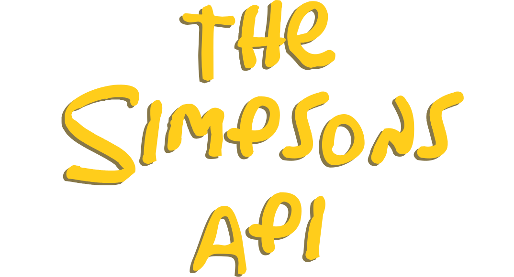

# 🎬 The Simpsons — Recreación de la transición de Fortnite

<div align="center">
  
</div>

Quise recrear una de mis partes favoritas de Fortnite x Los Simpson: el momento en que la cámara atraviesa el título y entra en otra escena. En esta versión, el scroll te lleva del cielo a la sala de Los Simpson a través de la **«P» de Simpsons**. El proyecto está hecho con Astro, GSAP, ScrollTrigger y Tailwind CSS.


## La clave de la animación actual

**El título y el recorte comparten la misma transformación, y la sala se encuadra a partir de esa misma escala.** La implementación está en [`Hero.astro`](src/components/Hero.astro).

Una prueba intermedia usaba la «O». El encuadre final recupera la «P» del prototipo para que la entrada quede justo en el centro de la pantalla.

1. **La «P» abre un hueco real.** El interior de la letra se toma del SVG original y se usa como la zona negra de una máscara. Esa zona deja ver la sala que está detrás del cielo y las nubes. La foto llena el hueco desde el inicio.
2. **El zoom parte de un punto fijo.** El centro del `viewBox` está en la abertura de la «P». En cada actualización se aplica la misma transformación al título y al recorte, de modo que ambos crecen alrededor de ese punto. El encuadre inicial recupera la distribución original de las nubes y limita el título a su tamaño nativo en pantallas anchas, con el nuevo degradado azul.
3. **La sala crece sin deformarse.** El código proyecta los bordes del hueco a la pantalla y calcula el tamaño mínimo de la foto para cubrirlos. La foto se mueve y escala con `transform`, manteniendo su proporción de 16:9. Al acercarse al tamaño de la pantalla, el encuadre se ajusta hacia el sofá.
4. **La sala toma toda la pantalla.** Para saber hasta dónde ampliar el título, el código calcula cuándo las cuatro esquinas de la pantalla caben en una elipse inscrita en la «P». En ese punto el cielo y el título se pueden ocultar sin que se vea un corte. Entonces entran en secuencia las tarjetas de la familia, que se cargan desde [The Simpsons API](https://thesimpsonsapi.com/).

El cálculo central en `drawCamera()` es este:

```js
const scale = startScale * (endScale / startScale) ** camera.progress;
const transform = `translate(${centerX} ${centerY}) scale(${scale}) translate(${-centerX} ${-centerY})`;

cameraLayers.forEach((layer) => layer.setAttribute("transform", transform));
```

Cada tramo igual de `camera.progress` multiplica la escala por el mismo factor. Eso hace que el acercamiento se sienta gradual aunque el hueco termine mucho más grande que al inicio.

### Por qué funciona también al regresar

CSS mantiene la escena en pantalla con `position: sticky`. Una sola timeline de GSAP abre las cortinas de nubes, avanza la cámara y muestra los personajes. ScrollTrigger vincula esa timeline al desplazamiento y `scrub: 0.35` suaviza el seguimiento.

Al subir, la timeline recorre los mismos valores en sentido inverso. Para un mismo valor de `camera.progress`, `drawCamera()` calcula el mismo tamaño y encuadre de la sala en ambas direcciones. Así el hueco y la foto vuelven juntos al estado inicial, con la proporción de la imagen intacta. Al redimensionar la ventana se recalculan las escalas y la cobertura. Con la preferencia de movimiento reducido, se muestra directamente la sala.


## Recursos

- [Documentación de GSAP](https://gsap.com/docs/v3/)
- [Documentación de ScrollTrigger](https://gsap.com/docs/v3/Plugins/ScrollTrigger/)
- [Fortnite](https://www.fortnite.com/)

**¡D'oh! 💛**
